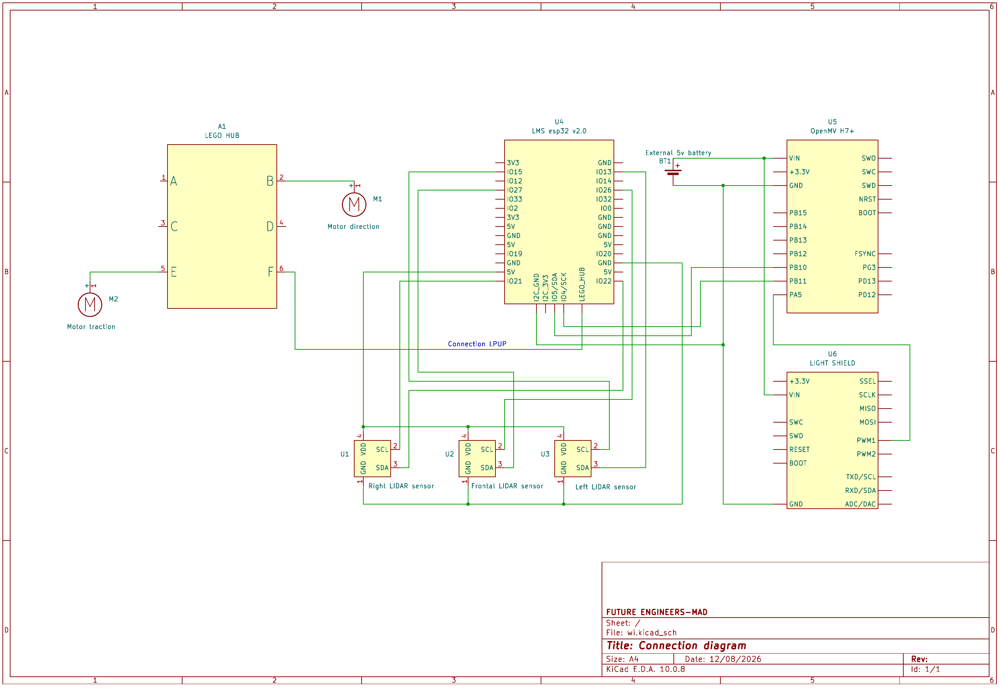
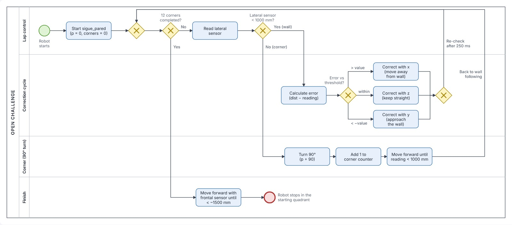
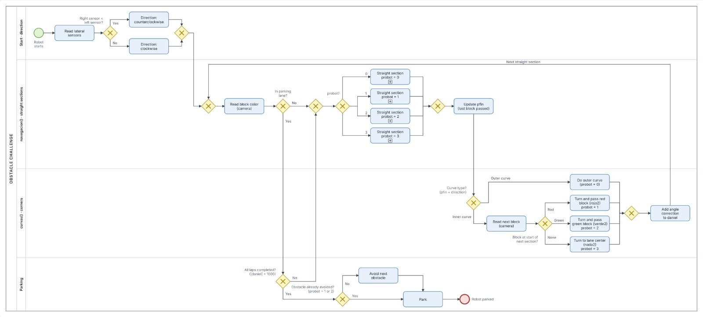

# WRO 2026 Future Engineers

## Table of Contents

* [About the Team](#about-the-team)
* [About CarloBot](#about-carlobot)
* [Background](#background)
* [Hardware Architecture](#hardware-architecture)
* [Robot Structure](#robot-structure)
* [Power Management](#power-management)
* [Software Architecture](#software-architecture)
* [Challenge Strategies](#challenge-strategies)
* [Testing and Improvements](#testing-and-improvements)
* [Videos](#videos)
* [How to Run](#how-to-run)

## About the Team

* Team name: MAD Engineering
* Academy: Game Changer Robotics Academy, El Salvador
* Competition: WRO 2026, Future Engineers category
* Coach: Carlos España

| Member | Role |
|---|---|
| Manuel Andrés Vásquez González | Lead programmer. Central logic, PID controllers, Open and Obstacle Challenge |
| Antonio José Daniel Borst Fortín Magaña | Mechanical design and construction. Chassis, steering, structural stability |
| Daniel Antonio Salazar Carvajal | Electronics, camera configuration, data transmission and documentation |

MAD comes from the first letter of our names: Manuel, Antonio and Daniel. CarloBot is named after our coach, Carlos España, who has guided us through the whole process at the Game Changer Robotics Academy.

We are part of the Future Engineers division of Game Changer Robotics, an academy in El Salvador that teaches engineering through real competition projects. This is our second international season. We competed at WRO Singapore 2025 representing El Salvador, and what we saw there shaped the 2026 version of CarloBot.

<!-- Previous team photo, kept in case it is still wanted:

-->

## About CarloBot

CarloBot is a fully autonomous self-driving robot built for WRO 2026 Future Engineers. A LEGO MINDSTORMS Robot Inventor Hub (set 51515) controls the motors, an ESP32 board reads the sensors, and an OpenMV H7 Plus camera detects the colored traffic signs. An LED light shield on the camera adjusts its brightness to the light in the room, so the colors look the same under different lighting. Nobody touches it during a run.

We redesigned the robot from scratch this season after Singapore 2025, where we found the limits of the previous version. The biggest change was the height. We lowered the chassis from 23 cm to 17 cm, which lowered the center of gravity. With the lower center of gravity the robot can take corners faster without losing traction.

Every design decision answers a problem we found while testing. The three independent LiDAR buses came from an I²C address conflict. The non-blocking state machine in the ESP32 came from PUPRemote connection losses. LAB instead of RGB for color detection came from failures under the lighting of a competition venue. Nothing here started as theory. Each change came after something failed in a test.

### Key Design Principles

| Principle | Implementation | Measurable Result |
|---|---|---|
| Compactness | Height reduced 26.1% (23 cm to 17 cm), motors moved toward the center | Faster corners without losing traction |
| Rigidity | Full LEGO brick chassis, no flex at the sensor mounting points | Consistent sensor readings at competition speed |
| Controllability | Two controllers: a turn PD controller (IMU) and a trajectory PID (heading lock) | The IMU corrects the heading on every straight and every turn |
| Reliability | Non-blocking ESP32 code, timeout fallbacks on every channel | The ESP32 reconnects to the Hub by itself if the link drops |

## Background

CarloBot is the seventh model of a design we have been building for two seasons. Last season's robot, La Tigresa del Oriente, went through six models, reached the national finals and then the international final in Singapore. This year we built only one robot, because we already knew what had failed before. More photos of the earlier models are in the [`11_Background_of_CarloBot`](General%20Photos/CarloBot_Fotos/11_Background_of_CarloBot) folder (`TO1` to `TO6` are models 1 to 6).

| Model | Photo | What we built and what we learned |
|---|---|---|
| 1 |  | Our first model. We tested different steering layouts and a gearbox for traction to get used to the challenge. It had no sensors and no camera. |
| 2 |  | We added three LEGO sensors (one on each side and one at the front) and a HuskyLens camera to see the blocks. Steering used a worm gear, which was far too slow to complete a turn. |
| 3 |  | We set the obstacle challenge aside and worked only on steering and side wall detection. The sensors moved to a 45 degree angle to see the walls better, and gears in the steering made turns faster and more precise. |
| 4 |  | We added a color sensor underneath to read the lines on the track, more LiDAR sensors for more precise turns, and brought the camera back for obstacle detection. Everything was connected through an ESP32 board, and the steering system was refined. |
| 5 |  | The version we took to the national finals. The camera's own light was too weak to detect blocks reliably, so we added external lamps driven through an optocoupler relay, powered by AAA batteries. |
| 6 |  | The version for the Singapore final. At the national final we found that the LiDAR sensors we used gave bad readings against black walls, so we replaced them with ultrasonic sensors. We also lowered the lights so the blocks were easier to see, and raised the structure so the camera could be tilted down for a better view of the blocks. |
| 7 |  | CarloBot, the robot we used for the whole 2026 season. It is much smaller than the previous one, uses an OpenMV H7 Plus camera, and reads three TF-Luna LiDAR sensors through an ESP32 board. The TF-Luna sensors are more precise, work at wider angles to the wall, and read the same whatever the color of the wall. The lighting is easier to operate and runs from an external power source so it does not drain the Hub battery. The steering is now connected straight to the motor instead of through gears, and the drive uses a 1:1 gear connection. |

What we kept and what we changed:

* We kept the idea of a compact LEGO chassis with a camera that finds the colored pillars.
* We changed the distance sensors twice. LiDAR gave bad readings on black walls, ultrasonic sensors were our fix for Singapore, and this year the three TF-Luna sensors replaced them (see [Decisions and Risks](Documentation/Decisions_and_Risks.md)).
* The camera went from a HuskyLens to an OpenMV H7 Plus, and the lighting moved from lamps on AAA batteries to an LED shield on its own power bank.
* Building and testing six models taught us what to change before building. That is why CarloBot did not need several rounds of redesign this season.

## Hardware Architecture

CarloBot has three processing units that talk to each other in real time: the OpenMV camera, the ESP32 board and the LEGO Hub. The diagram shows what each one does and what it sends to the next one, from the camera image to the motors.

### Electrical Schematic

This is the connection diagram of the robot, drawn in KiCad. It shows the Hub, the two motors, the ESP32 board, the three LiDAR sensors, the OpenMV camera, the LED light shield and the external 5 V battery that powers the camera and the shield. A PDF version is [here](Electronics/Schematic/Connection_Diagram.pdf).

### Components

| Component | Specs | Role |
|---|---|---|
| LEGO MINDSTORMS Robot Inventor Hub (set 51515) | 7.3V Li-ion, 6 ports, 6-axis IMU | Main controller. Processes and runs the Open and Obstacle challenge programs |
| LMS-ESP32 v2.0 board | ESP32, 2 MB memory, 4 MB storage, MicroPython 1.24 preloaded | Sensor bridge. Reads the 3 LiDARs and passes camera data to the Hub through PUPRemote |
| OpenMV H7 Plus | STM32H7 480 MHz, 32 MB SDRAM, 140 degree wide angle M12 lens, 230 to 240 mA when active | Computer vision. Detects colored blocks, finds their position, runs the LED brightness PID |
| TF-Luna LiDAR ×3 | 850 nm VCSEL, 0.2 to 8 m, ±6 cm, 100 Hz default | Distance sensing for corners, wall following and obstacle position |
| Motor C | LEGO Large Angular Motor | Traction on the rear axle, counterclockwise direction |
| Motor B | LEGO Large Angular Motor | Steering on the front axle, clockwise direction, ±60 range in competition |

### ESP32 Pin Mapping

| Sensor | SDA | SCL | Bus |
|---|---|---|---|
| TF-Luna 1 (Right) | GPIO 22 | GPIO 21 | SoftI2C #1 |
| TF-Luna 2 (Front) | GPIO 27 | GPIO 26 | SoftI2C #2 |
| TF-Luna 3 (Left) | GPIO 13 | GPIO 15 | SoftI2C #3 |
| UART from OpenMV | RX: GPIO 4 | TX: GPIO 5 (wired, not used by the software) | UART1 at 115,200 bps |
| PUPRemote to Hub | Port F cable | Port F cable | LPF2 protocol |

Why three independent I²C buses? An I²C address works like a house number: every device on a bus has one, and the controller uses it to say which device it is talking to. All three TF-Luna sensors have the same address (0x10), so on a single bus the ESP32 could not tell them apart. Multiplexers or address remapping add delay and complexity. With three separate SoftI2C buses there is no address conflict, and the three sensors can be read one after another without getting in each other's way.

## Robot Structure

CarloBot is built on a chassis made only of LEGO bricks and beams, with no flex at the sensor mounting points. The camera sits on top at the front. The three TF-Luna LiDAR sensors are mounted in 3D printed cases, one at the front, one on the left side and one on the right side. The steering motor is connected straight to the steering, and the drive motor reaches the wheels through a 1:1 gear connection. The 3D files for the printed parts are in `Mechanics/3D Models`. The photos below show the six sides of the robot, so the whole structure can be checked.

| Front | Rear |
|---|---|
|  |  |
| The end with the camera and the front LiDAR | The opposite end |

| Left | Right |
|---|---|
|  |  |
| Left side, with the left LiDAR | Right side, with the right LiDAR |

| Top | Bottom |
|---|---|
|  |  |
| Seen from above | Seen from below, with the wheels and the drive gears |

## Power Management

CarloBot runs from two separate power sources. The Hub battery feeds the motors, the ESP32 and, through the ESP32, the three LiDAR sensors. The camera and its LED shield run only from a Steren MOV-1058 power bank (5 V, 5000 mAh). We kept them apart on purpose: if the ESP32 got power from the Hub and from the power bank at the same time, it could be overloaded. The only connection between the two sides is the data cable, which also carries a shared GND: the ground wire runs from the power bank cable to both the camera and the ESP32, and the camera VIN is fed from the power bank. Without that common ground the UART signal from the camera would not be read correctly.

The TF-Luna sensors accept 3.7 V to 5.2 V and are powered from the ESP32, which gets its power from the Hub. Each TF-Luna has an I²C enable pin (pin 5, the yellow wire). It is connected to GND, which makes the sensor start in I²C mode. If that pin is left floating or at 3.3 V the sensor starts in serial mode and does not answer on I²C.

Hub battery side:

| Component | Voltage | Typical Current | Power |
|---|---|---|---|
| LEGO Hub (processing) | 7.3V | ~300 mA | ~2.2 W |
| Drive motor (under load) | 7.3V | 400 to 800 mA | 2.9 to 5.8 W |
| Steering motor | 7.3V | 100 to 300 mA | 0.7 to 2.2 W |
| ESP32 (240 MHz, active) | 3.3V | ~50 mA | ~0.17 W |
| 3× LiDAR TF-Luna (70 mA each) | 5V each | ~210 mA in total | ~1.05 W in total |
| Total (estimated) | | | ~7 to 11 W active |

Power bank side:

| Component | Voltage | Current | Source |
|---|---|---|---|
| OpenMV H7 Plus, active | 3.3V | 230 to 240 mA | Datasheet |
| LED shield, LEDs on | | 384 mA | Product page |

Together that is about 0.62 A, well under the 2 A the power bank can deliver. These are datasheet maximums, not measurements from our own runs.

The Hub battery (7.3V, 2,100 mAh, about 15.3 Wh) gives an estimated 1.3 hours at full load, calculated from the table above. A competition run lasts about 3 minutes and uses around 0.5 Wh, close to 3.5% of the capacity, so the voltage stays steady and the motors behave the same from the first run to the last. The robot never starts a run on a low battery, because we rotate two batteries (see below).

### Battery rotation

We have two Hubs and two batteries. One Hub is in the robot. The other Hub is only used as a charger. While one battery powers the robot, the other one charges in the spare Hub. When the battery in the robot drops to 70%, we swap it for the charged one and put the used battery on charge. At startup the program prints `battery.voltage()`, so we can check the battery before every run.

## Software Architecture

The code is split into four Python files, one for each piece of hardware.

### `Pro_CAM.py` (OpenMV camera vision)

Runs on the OpenMV H7 Plus. It captures frames at QVGA (320×240) and:

* Detects red and green blobs with LAB color thresholds:
  * Red: `(0, 58, 14, 127, -128, 127)`
  * Green: `(30, 90, -128, -10, 0, 127)`
* Why LAB and not RGB? The L (lightness) channel is separate from the color channels, so thresholds stay stable when the room light changes. That matters in venues with different lighting from our practice area.
* Finds the obstacle position (left = 1, right = 2) with two ROIs in the lower part of the frame: `ROI_LEFT = (20, 170, 140, 16)` and `ROI_RIGHT = (160, 170, 140, 16)`
* Adjusts the LED brightness (capped at 60%) with a brightness PID loop:
  * `PWM_new = (1 − α) · PWM_curr + α · (PWM_curr + Kp · brightness_error)`
  * α = 0.20, Kp = 0.6, target brightness = 60, max PWM = 60%
* Looks at the lower part of the frame, where the pillar base is. The picture below shows the two ROIs (cyan on the left, magenta on the right) with a green pillar detected on the right:

  

* Sends results over UART as `C:<color>,P:<position>\n` at intervals of up to 80 ms, and forces a heartbeat every 250 ms even if nothing changed
* On startup sends 10 safe messages `C:0,P:0` before entering the main loop

Camera codes sent to the ESP32:

| Detected Situation | cam Channel Code |
|---|---|
| Nothing detected | 0 |
| Red, left side | 11 |
| Red, right side | 12 |
| Green, left side | 21 |
| Green, right side | 22 |

### `Con_ESP32.py` (ESP32 sensor bridge)

Runs on the ESP32 in MicroPython. It collects the sensor data and passes it to the Hub.

How the ESP32 works, step by step:

1. On startup it waits until PUPRemote has connected with the Hub (`conectar_hub()`).
2. In a loop it asks one LiDAR at a time for a distance, without waiting, and moves on to the next sensor while the answer arrives.
3. It reads the line the camera sends over UART and turns it into one code (0, 11, 12, 21 or 22).
4. If a sensor or the camera goes quiet for too long, its value goes back to 0.
5. It puts the three distances and the camera code in the `dist` and `cam` channels, and the Hub reads them from there.
6. If the connection with the Hub drops, it reconnects by itself and sends the last values again.

The details of each part:

* Reads distance from the 3 TF-Luna LiDARs over three independent SoftI2C buses at 400 kHz
* Each reading uses the command `0x5A 0x05 0x00 0x06 0x65`. The 9-byte answer is checked with `CS = (Σ byte[0..7]) & 0xFF == byte[8]`, and the distance is `d = byte[2] | (byte[3] << 8)`
* Uses a non-blocking state machine for each sensor (FREE, WAITING, FREE):
  * FREE: if 6 ms have passed, send the command and go to WAITING
  * WAITING: if 3 ms have passed, read, validate, move to the next sensor and go back to FREE
  * Update rate is about 37 Hz per sensor, and a full cycle of the 3 sensors takes about 27 ms
* UART parsing works directly on bytes (`color = byte − 0x30`), with no `decode()` or `split()`, to keep heap use low
* Shares the data with the Hub through PUPRemote (LPF2 protocol) on Port F:
  * `cam` channel: `int16`, the camera detection code
  * `dist` channel: `3× int16`, LiDAR distances in mm (0 to 32,767)
* Calls `pr.process()` about every 1 ms. If the connection drops, it calls `conectar_hub()` to negotiate again and `restaurar_canales()` to publish the last known values, so nobody has to restart anything by hand
* A `bytearray` buffer for UART reads avoids creating new heap objects on every read
* `gc.collect()` runs every 2 seconds to avoid heap fragmentation
* Timeouts: if a LiDAR is silent for more than 300 ms its distance goes to 0, and if the camera is silent for more than 250 ms the cam value goes to 0

### `Ope_Chall.py` (Open Challenge)

Runs on the LEGO Hub with Pybricks. It drives the Open round.

* Finds the track direction at startup from the side LiDAR readings, with no manual setup
* If the right sensor goes above 1,000 mm first the robot goes clockwise (`sigue_pared1`), and if the left one does it goes counterclockwise (`sigue_pared2`)
* Wall following uses `drive_with_heading_lock()` with ±12° heading corrections around the accumulated base heading `p`
* It tries to stay 230 mm from the right wall when going clockwise and 250 mm from the left wall when going counterclockwise, with a tolerance of 25 mm
* At a corner (wall distance above 1,000 mm) the robot makes the PID turn, waits 1 second, drives for 600 ms and then needs 3 wall readings in a row below 1,000 mm before it goes on
* After 12 corners (3 full laps) it drives to the finish line and stops

### `Obs_Chall.py` (Obstacle Challenge)

Runs on the LEGO Hub with Pybricks. It builds on the Open Challenge and avoids obstacles in both directions.

* Finds the direction at startup (`sentido = 1` counterclockwise, `sentido = 2` clockwise), runs the matching exit maneuver (`salida_counter()` or `salida_clock()`) and then loops through 12 navigation and corner cycles
* The IMU always starts at 0. The variable `daniel` is the heading the robot should have, and after each corner it adds 90.12° (clockwise) or subtracts 90.55° (counterclockwise). Those two numbers are measured, not 90 exactly, and they cancel the drift so the error does not pile up over several laps
* The variable `probot` tells the program where the robot is on the straight it is driving: 0 means no pillar has been handled yet after the last corner, 1 or 2 mean the camera saw a red or green pillar right after the corner, and 3 means it saw nothing and has to search

Clockwise evasion:
* Red block: `rojo()` turns to about +48° (right), drives until the front LiDAR reads about 300 mm, and turns back to the base heading
* Green block: `verde()` turns to about −52° (left), drives until the front LiDAR reads about 285 mm, and turns back to the base heading

Counterclockwise evasion (mirrored):
* Red block: `rojo_ccw()` turns to about +45°, drives until the right LiDAR reads 340 mm or less, and turns back
* Green block: `verde_ccw()` turns to about −52°, drives until the left LiDAR reads 250 mm or less, and turns back

Helper functions:
* `look_for_block()` drives at a set heading and speed until the camera sees a block or the front LiDAR reads less than a given distance. We use it after the robot has passed one block, to find the next one in the same lane. The LiDAR condition is there because a lane does not always have a second block, so something other than the camera must be able to stop the function.
* `move_for_distance()` moves the robot a set distance. It is for places where the distance sensors cannot be trusted, such as the parking lane, where they would be reading the parking walls. It turns the distance into a drive time using the wheel circumference (17.5 cm) and splits the movement in two: 80% of the distance at the speed given, and the last 20% at a much slower speed, so the robot does not have to stop suddenly from full speed.

### Shared Controllers

`giro_con_imu(steering, target_angle, speed)` turns the robot to an exact IMU heading. It is a PD controller (the I term is switched off).

| Parameter | Value | Reason |
|---|---|---|
| Kp | 2.0 | Main correction force |
| Ki | Off | Not needed |
| Kd | 0.8 | Calms the oscillation near the target |
| Tolerance | ±2° | Stop condition |
| Deadband | ±1° | Avoids small oscillations |
| Min speed | 250 (Obs_Chall) and 100 (Ope_Chall) | A higher floor shortens the slow final approach |

The inputs are the steering (how much the robot steers during the turn, set at the start and not changed), the target angle, and the speed. The turn ends when the robot is within 2 degrees of the target. The speed is a maximum, not a constant: the controller lowers it as the robot gets close to the target, and it never goes below the minimum speed. We use PD and not PID because the I term only fixes steady errors that the other two terms leave behind, and here they cannot happen. The steering is fixed and the minimum speed keeps the robot moving toward the target, so the error never gets stuck at one value.

`drive_with_heading_lock(heading, speed, sensor, value, confirmations, stop)` drives straight and corrects with the IMU.

| Parameter | Value | Reason |
|---|---|---|
| Kp | 2.2 | Faster answer while moving |
| Ki | 0.1 | Fixes slow drift without making it unstable |
| Kd | 1.5 | Strong damping for straight lines |
| MAX_STEER | ±50 | Limits the steering correction |
| Deadband | 0.2° | No needless corrections at speed |
| Confirmation | 5 readings | Avoids false stops |

The inputs are the heading to hold, the drive speed, the stop condition and how to stop:

* `sensor` chooses what ends the movement: the front LiDAR (1), the left LiDAR (2), the right LiDAR (3) or the stopwatch (5).
* `value` is the limit for that sensor, in millimeters for the LiDARs and in milliseconds for the stopwatch.
* `confirmations` is how many readings in a row must meet the condition before it stops, so one wrong reading does not end the movement.
* `stop = 1` slows the robot to zero when the condition is met, and `stop = 2` leaves it moving.

We use it in the Obstacle Challenge for almost every straight movement, and the helper functions below are built on top of it.

### Speeds

Speeds in the code are degrees per second of the traction motor. The Open Challenge drives along the walls at 500. The Obstacle Challenge uses named constants (`SPEED_200` to `SPEED_850`) that go from 450 for slow, careful approaches to 680 for the hard swing into a pillar, with 500 as the standard cruise speed. They are grouped in one place so they can be tuned together.

## Challenge Strategies

### Open Challenge

The Open Challenge program uses two functions, `sigue_pared1()` for clockwise and `sigue_pared2()` for counterclockwise. They do the same thing in opposite directions. At the start, CarloBot drives forward and reads both side LiDAR sensors. If the right sensor goes above 1,000 mm first, it runs `sigue_pared1()`. If the left one does, it runs `sigue_pared2()`.

What `sigue_pared` does: it follows a wall using the sensor that faces it. It has three inputs. `dist` is the distance the robot tries to keep from the wall, `value` is a threshold around that distance inside which the robot does not correct, and `speed` is the driving speed (500 in competition). The correction cycle only runs while that sensor reads less than 1,000 mm.

How the corrections work: there are four constants, x, y, z and p.

* x moves the robot away from the wall.
* y moves the robot toward the wall.
* z keeps the robot straight when the distance is inside the threshold.
* p grows by 90 after every turn, so the other three work the same way no matter how many corners have been made.

Each correction is a `drive_with_heading_lock()` with the target heading set to p plus x, y or z, and it only runs for 250 ms. Then the robot reads the sensor again to see if it still has to correct or if it has reached a corner.

How it handles corners: when the wall sensor reads more than 1,000 mm, the robot has reached a corner. It makes the 90 degree turn with the IMU, waits 1 second, drives forward 600 ms, and goes back to the correction cycle once it has three readings in a row below 1,000 mm.

How it stops: after 12 corners (3 full laps) the robot drives forward until the front LiDAR reads less than about 1,400 mm, which leaves it inside the quadrant where it started. The only differences between `sigue_pared1()` and `sigue_pared2()` are the sensor they use, the direction of the turn, and whether p grows or shrinks.

### Obstacle Challenge

The Obstacle Challenge program runs as a cycle of two functions, `navegacion()` and `curvas()`, repeated 12 times (3 laps of 4 corners). `navegacion()` takes the robot along one straight section and deals with the pillars on it. `curvas()` takes it through the next corner. The code is written twice, once for each direction (`navegacion_ccw()` and `curvas_ccw()` for counterclockwise, `navegacion()` and `curvas()` for clockwise). The explanation below uses the counterclockwise names, and the clockwise side works the same way mirrored.

The diagram below shows the whole program, and the sections after it explain each part.

#### Direction

At startup the robot compares its two side LiDAR sensors. If the right sensor reads less than the left one, the right wall is closer, so the robot is going counterclockwise (`sentido = 1`). If the left sensor reads less, it is going clockwise (`sentido = 2`).

#### The `probot` variable

`probot` tells `navegacion()` how the robot left the last corner, so it knows what it can expect on the next straight:

* `probot = 0`: the normal position. The robot took the outer curve and starts the straight in its usual place.
* `probot = 1`: during the corner the robot already passed a red pillar (the first pillar of the next straight).
* `probot = 2`: during the corner the robot already passed a green pillar.
* `probot = 3`: there was no pillar in the first position, so the robot left the corner in the center of the lane.

Value 0 comes from the outer curve, and values 1, 2 and 3 come from the inner curve, where the camera looks at the start of the next straight before the robot commits to a movement.

#### `navegacion()`

Each `probot` value has its own branch, because the pillars the robot can still meet are different:

* `probot = 0`: the first position can hold a red pillar, a green pillar or nothing. If there is a pillar, the second position can hold another pillar or nothing. If the first position is empty, the only possibility left is one pillar afterwards, red or green. If the second position is also empty, the program runs `nada()`, which reads the side LiDAR sensors to find out which side of the lane the robot is on.
* `probot = 1`: the robot starts having passed the red pillar in the corner, and the next pillar can be red, green or none.
* `probot = 2`: the same, but after passing a green pillar.
* `probot = 3`: the robot is in the center of the lane, so the next pillar can only be green or red.

The variable `pfin` (posición final) records how the robot is leaving the straight. It is updated on the last movement of the straight, so if the straight has a green pillar and then a red one, only the red one counts when the robot chooses its corner. `curvas()` reads `pfin` to decide which curve to do.

#### `curvas()`

`curvas()` does two jobs: it drives the corner, and it updates the global angle offset `daniel` after every corner. `daniel` is the heading the robot should have, and it makes every movement relative to the section the robot is in. The movements are written once, and `daniel` adjusts them as the gyroscope keeps going up or down. For clockwise movement the offset grows by `correctionClock` after each corner, and for counterclockwise movement it decreases by `correctionCounter`.

Inside `curvas()` there are two cases. `pfin = 1` always runs the red curve (`curva_r_ccw()` or `curva_r()`) and `pfin = 2` always runs the green curve (`curva_v_ccw()` or `curva_v()`), but each one does something different in each direction. Going counterclockwise, the red curve is the outer curve and always ends with `probot = 0`. The green curve is the inner curve, so it is the one that uses the camera. It reads the first position of the next straight and does one of three things:

* Red pillar: `rojo2_ccw()` does the corner and passes the red pillar in the same movement (`probot = 1`).
* Green pillar: `verde2_ccw()` does the corner and passes the green pillar in the same movement (`probot = 2`).
* No pillar: `nada2_ccw()` does the corner and leaves the robot in the center of the lane (`probot = 3`).

Clockwise it is mirrored: the red pillars are the ones that leave the robot near the inner wall, so `curva_r()` is the one that uses the camera.

#### Parking

At the end of each lap (after 4, 8 and 12 corners) the robot is in the parking lane section. The program knows this when `daniel` is within about 5 degrees of `correctionCounter` (or `correctionClock`) multiplied by 4, 8 or 12. In that case `navegacion()` takes the `else` branch, which follows the same `probot` logic as the normal branch. The robot only tries to park when `daniel` is beyond 1000 or below −1000, which means all the laps are done, and only after it has avoided one pillar in that section (this includes a pillar passed inside a curve, as with `probot = 1` and `probot = 2`). Then `parqueo2()` (counterclockwise) or `parqueo5()` (clockwise) runs.

### Risk Management

| Risk | Root Cause | Mitigation |
|---|---|---|
| LiDAR dropout | Loose cable or I²C timeout | `DIST_TIMEOUT_MS = 300`, distance goes to 0 |
| Old camera reading | UART loss or OpenMV lag | `CAM_TIMEOUT_MS = 250`, cam goes to 0 |
| IMU heading drift | Angle error that adds up | The IMU starts at 0 and the target heading grows by 90.12° (clockwise) or 90.55° (counterclockwise) per corner, measured values that cancel the drift |
| PUPRemote disconnect | Blocking code in the ESP32 | `pr.process()` about every 1 ms, non-blocking code |
| Battery performance drop | Discharge during the session | Two batteries in rotation, swapped at 70%, checked with `battery.voltage()` at startup |

## Testing and Improvements

### Test Log

| # | Objective | Failure Observed | Change Applied | Status |
|---|---|---|---|---|
| 1 | Reduce robot height | Unstable in fast corners | Motors moved toward the center, height of 17 cm | Fixed |
| 2 | Non-blocking ESP32 | PUPRemote lost the connection because of `sleep_ms()` | FREE/WAITING state machine for each sensor | Fixed |
| 3 | Red LAB threshold | False negatives under competition lighting | LAB range widened to `(0, 58, 14, 127, -128, 127)` | Fixed |

### Key Engineering Lessons

Software matters as much as hardware. We did not notice that `sleep_ms()` was blocking PUPRemote until we measured how often the Hub was really getting updates. Once we knew the cause the fix was easy, but finding it took careful measuring.

LAB over RGB was an engineering decision, not a taste. RGB thresholds move when the light gets brighter or darker. LAB keeps luminance apart from color, so detection stays stable when the total brightness changes. That removed a whole group of failures.

A lower center of mass gave us more stability, and we have the numbers. Going from 23 cm to 17 cm let us take corners faster without losing traction. The result was immediate and came straight from the physical change.

Test one variable at a time. If you change several things together you cannot tell which one helped or which one broke the run.

## Videos

Both videos show CarloBot running a full challenge without anyone touching it.

| Challenge | Video |
|---|---|
| Open Challenge | [WRO Open Challenge MAD Engineering](https://www.youtube.com/watch?v=Sayu6AHdB2I) |
| Obstacle Challenge | [WRO Obstacle Challenge MAD Engineering](https://www.youtube.com/watch?v=Lf-R_jDDapE) |

## How to Run

### Requirements

* LEGO MINDSTORMS Robot Inventor Hub (set 51515) with [Pybricks](https://pybricks.com/) firmware
* LMS-ESP32 v2.0 board with [MicroPython](https://micropython.org/) (v1.20 or newer)
* OpenMV H7 Plus with the [OpenMV IDE](https://openmv.io/pages/download)
* `pupremote` library on both the LEGO Hub and the ESP32

### Steps

1. Flash `Pro_CAM.py` onto the OpenMV H7 Plus with the OpenMV IDE. It starts by itself when powered.
2. Save `Con_ESP32.py` on the ESP32 with Thonny as `main.py`, so it loads as the main program and starts by itself when the board is powered.
3. Connect the ESP32 to Port F of the LEGO Hub with the LPUP cable that comes with the board.
4. Upload `Ope_Chall.py` or `Obs_Chall.py` to the LEGO Hub with Pybricks.
5. Press the center button on the Hub to start the run.

Startup order matters. Turn on the camera first (it runs from its own power bank), then the Hub, which also powers the ESP32, and then press the Hub button. The camera sends 10 safe `C:0,P:0` messages when it boots, so starting in a different order can leave you with zero readings in the first few cam values.

MAD Engineering, WRO 2026 Future Engineers
Game Changer Robotics Academy, El Salvador

